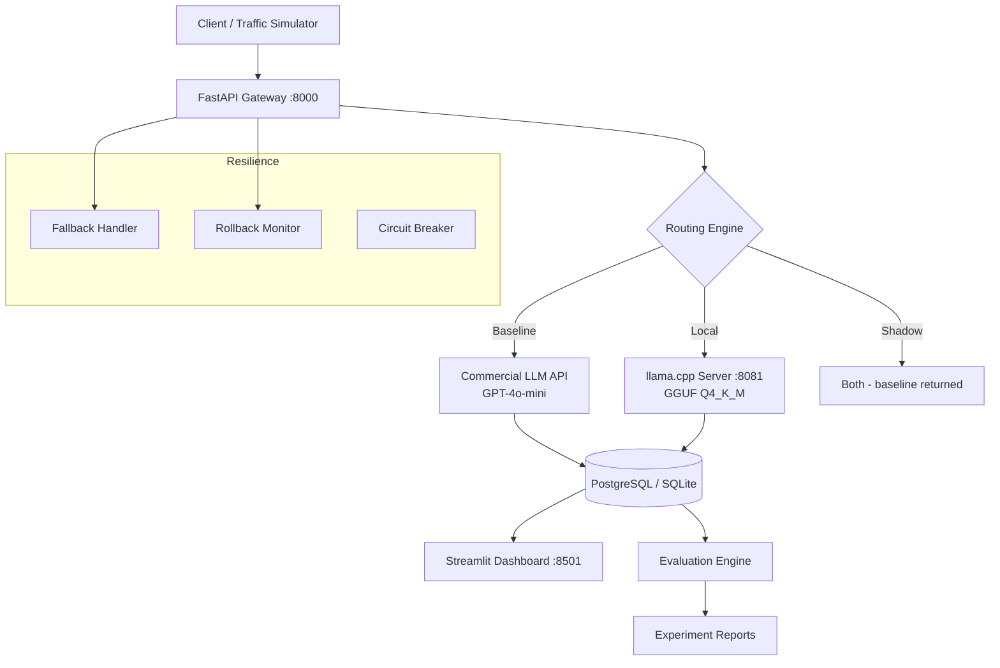

# Fine-Tune, Serve, and Route: An Intelligent LLMOps Cost & Latency Governance Platform

[](https://github.com/hetsoni1313/MLSE-Project/actions/workflows/ci.yml)
[](https://www.python.org/downloads/)
[](https://opensource.org/licenses/MIT)

A production-grade LLMOps platform that fine-tunes a small language model, serves it locally via llama.cpp, and routes requests intelligently between a commercial API and the local model — with automatic fallback, rollback, cost monitoring, and a professional dashboard.

## 🎯 Problem Statement

Commercial LLM APIs are expensive at scale. This platform demonstrates that a smaller, fine-tuned local model can reduce inference costs while maintaining acceptable quality, and that the transition can be performed safely through intelligent routing, monitoring, and automatic rollback.

## 🏗️ Architecture



## ✨ Key Features

### Intelligent Routing
- **Weighted A/B routing** with configurable traffic splits (100/0, 90/10, 50/50, 0/100)
- **Sticky routing** via deterministic user-ID hashing for consistent experiment assignment
- **Shadow mode** — local model runs silently alongside baseline for comparison
- **Canary deployment** — gradual rollout through configurable stages (5% → 25% → 50% → 100%)
- **Dynamic configuration** — change routing without restarts via admin API

### Resilience & Safety
- **Automatic fallback** — when local model fails, falls back to commercial API
- **Automatic rollback** — monitors accuracy, error rate, and p95 latency; rolls back to baseline when thresholds are violated
- **Circuit breaker** — prevents cascading failures from unhealthy local model
- **Fault injection** — deterministic testing framework for failure scenarios

### Cost Intelligence
- **Per-query cost tracking** with actual token counts
- **Break-even analysis** — finds the monthly query volume where local hosting becomes cheaper
- **Sensitivity analysis** — low/base/high hardware cost scenarios
- **Cost per 1,000 queries** comparison between API and local

### Monitoring & Observability
- **6-page Streamlit dashboard** with real-time metrics
- **Structured logging** with configurable redaction
- **Per-request database logging** with full audit trail
- **Experiment tracking** with MLflow integration

## 📦 Repository Structure

```
├── configs/          # YAML configurations (routing, pricing, thresholds, model)
├── src/llmops_governance/  # Core library (config, schemas, metrics, utils)
├── gateway/          # FastAPI gateway (API, routing, backends, resilience)
├── evaluation/       # Evaluation engine (metrics, cost, comparison)
├── dashboard/        # Streamlit monitoring dashboard (6 pages)
├── training/         # Fine-tuning pipeline (QLoRA, notebooks)
├── serving/          # llama.cpp local model serving
├── loadtest/         # Traffic replay and experiment scenarios
├── tests/            # Test suite (unit, routing, resilience, integration)
├── scripts/          # Setup, conversion, quantization, experiments
├── docs/             # Technical documentation
├── .github/workflows/ # CI/CD and model promotion gate
└── compose.yaml      # Docker Compose deployment
```

## 🚀 Quick Start

### Prerequisites
- Python 3.11+ (tested with 3.13)
- macOS (Apple Silicon) or Linux

### 1. Setup
```bash
# Clone and enter the project
cd MLSE-Project

# Create virtual environment and install
python3 -m venv venv
source venv/bin/activate
pip install -e ".[dev]"

# Download and prepare Banking77 dataset
python scripts/download_data.py
python scripts/prepare_data.py

# Copy environment template
cp .env.example .env
# Edit .env with your API key (optional — mock baseline available)
```

### 2. Start the Gateway
```bash
uvicorn gateway.main:app --host 0.0.0.0 --port 8000 --reload
```

### 3. Send a Request
```bash
curl -X POST http://localhost:8000/classify \
  -H "Content-Type: application/json" \
  -d '{"message": "How do I change my PIN number?"}'
```

### 4. Start the Dashboard
```bash
streamlit run dashboard/app.py --server.port 8501
```

### 5. Run Tests
```bash
pytest tests/ -v
```

### 6. Run Experiment Scenarios
```bash
python -m loadtest.replay --scenario baseline --requests 50
python -m loadtest.replay --scenario shadow --requests 50
python -m loadtest.replay --scenario canary_50 --requests 50
```

## 🔧 Configuration

### Routing (`configs/routing.yaml`)
```yaml
routing:
  mode: baseline          # baseline | weighted | shadow | canary
  baseline_percentage: 100
  local_percentage: 0
  sticky_enabled: true
```

### Rollback Thresholds (`configs/thresholds.yaml`)
```yaml
rollback:
  enabled: true
  evaluation_window: 100
  min_labelled_samples: 30
  min_accuracy: 0.85
  max_error_rate: 0.05
  max_p95_latency_ms: 5000
```

### Pricing (`configs/pricing.yaml`)
```yaml
pricing:
  provider: openai
  model: gpt-4o-mini
  input_price_per_mtok: 0.15
  output_price_per_mtok: 0.60
  currency: USD
```

## 📊 API Endpoints

| Method | Endpoint | Description |
|--------|----------|-------------|
| POST | `/classify` | Classify a banking message |
| GET | `/health` | Health check |
| GET | `/ready` | Readiness check (DB + backends) |
| GET | `/metrics` | Current gateway metrics |
| GET | `/admin/config` | Get routing config (requires API key) |
| PUT | `/admin/config` | Update routing config |
| GET | `/admin/rollback-history` | Rollback event log |
| POST | `/admin/reset-rollback` | Recover from rollback |
| POST | `/admin/faults` | Toggle fault injection (dev only) |

## 🧪 Experiment Scenarios

| Scenario | Description |
|----------|-------------|
| `baseline` | 100% commercial API traffic |
| `shadow` | Baseline + silent local execution |
| `canary_10` | 90/10 baseline/local split |
| `canary_50` | 50/50 traffic split |
| `full_local` | 100% local model traffic |
| `failure_test` | Local server failure → automatic fallback |
| `degraded` | Degraded accuracy → automatic rollback |

## 🐳 Docker Deployment

```bash
# Start core services (gateway + database + dashboard)
docker compose up -d

# Start with local model server
docker compose --profile full up -d
```

## 📈 Fine-Tuning Pipeline

1. Open `training/notebooks/colab_finetuning.ipynb` in Google Colab
2. Run all cells (requires free T4 GPU)
3. Download the merged model
4. Convert and quantize locally:
```bash
bash scripts/convert_to_gguf.sh ./merged_model
bash scripts/quantize_model.sh
bash scripts/start_server.sh
```

## 🔒 Security

- API keys stored in environment variables only (never in code/logs/Git)
- Admin endpoints protected by API key authentication
- Input validation on all endpoints
- Log redaction for sensitive data
- `.env` excluded from Git

## 📄 Documentation

- [Architecture](docs/architecture.md) — System design and component diagram
- [Methodology](docs/methodology.md) — Evaluation and experiment methodology
- [Cost Analysis](docs/cost_analysis.md) — Cost model and break-even methodology
- [Data Dictionary](docs/data_dictionary.md) — Database schema documentation
- [Deployment](docs/deployment.md) — Deployment guide
- [Troubleshooting](docs/troubleshooting.md) — Common issues and solutions
- [Demo Script](docs/demo_script.md) — 5-minute demonstration guide
- [Limitations](docs/limitations.md) — Known limitations

## 🏷️ Technology Stack

| Component | Technology |
|-----------|-----------|
| Gateway | FastAPI, Uvicorn, Pydantic |
| Database | PostgreSQL (production), SQLite (dev) |
| ORM | SQLAlchemy (async) |
| Dashboard | Streamlit, Plotly |
| Local Model | llama.cpp (GGUF Q4_K_M) |
| Fine-tuning | QLoRA, PEFT, TRL, Transformers |
| Experiment Tracking | MLflow |
| Testing | pytest, pytest-asyncio |
| CI/CD | GitHub Actions |
| Containerization | Docker, Docker Compose |
| Linting | Ruff |

## 📝 License

MIT License — see [LICENSE](LICENSE) for details.

## 🙏 Acknowledgments

- [Banking77 Dataset](https://huggingface.co/datasets/PolyAI/banking77) (PolyAI, CC BY 4.0)
- [Qwen2.5](https://huggingface.co/Qwen) (Alibaba Cloud)
- [llama.cpp](https://github.com/ggerganov/llama.cpp) (Georgi Gerganov)

