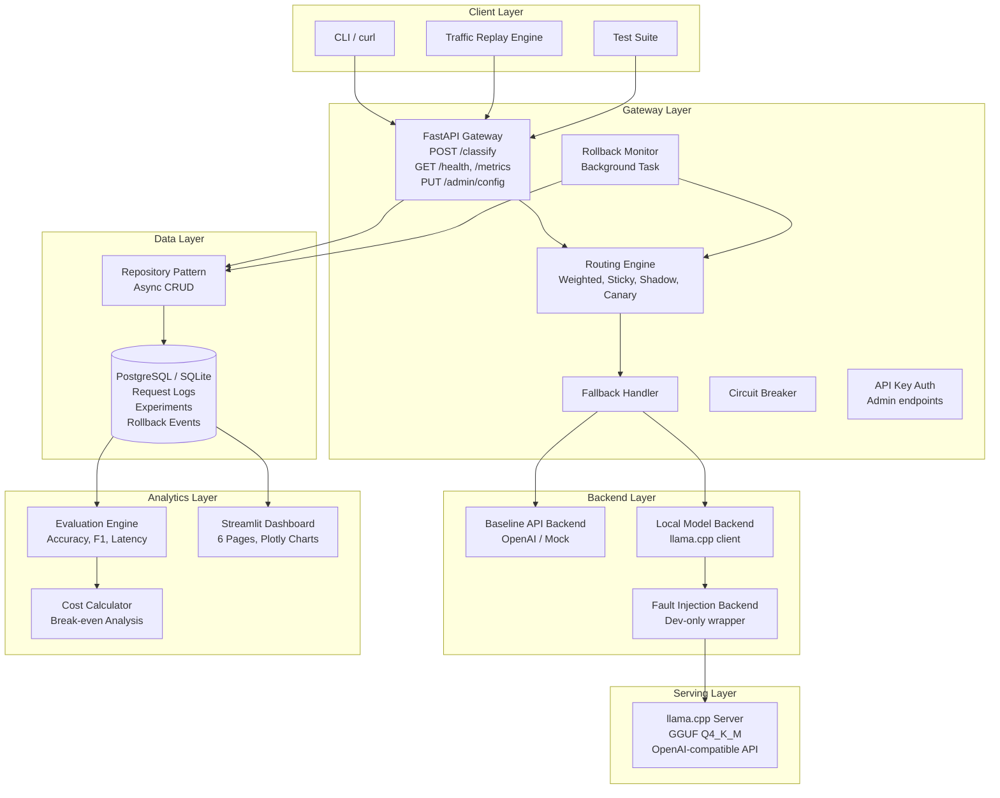

# System Architecture

## Overview

The LLMOps Governance Platform is a monolithic but modular system with clear separation of concerns.

## Architecture Diagram

## Component Responsibilities

### Gateway (`gateway/`)
- **main.py** — Application factory with lifespan management
- **api/** — FastAPI routers for classification, health, admin, metrics
- **backends/** — Abstract backend interface + baseline/local/fault-injection implementations
- **routing/** — Routing engine with weighted/sticky/shadow/canary strategies
- **resilience/** — Fallback handler, rollback monitor, circuit breaker
- **middleware/** — Authentication for admin endpoints

### Core Library (`src/llmops_governance/`)
- **config/** — Pydantic Settings with YAML + env-var loading
- **schemas/** — Request/response models
- **core/** — Banking77 labels, exceptions, constants
- **metrics/** — Database models, repositories, in-memory collector
- **utils/** — Hashing, timing, label validation
- **logging/** — Structured logging with redaction

### Evaluation (`evaluation/`)
- Pure-function metric computation (accuracy, F1, latency stats)
- Cost calculator with break-even and sensitivity analysis
- Model comparison and promotion gate logic
- Prediction runner for batch evaluation

### Dashboard (`dashboard/`)
- 6-page Streamlit application
- Real-time database queries via sync SQLAlchemy
- Plotly visualizations for all key metrics

## Data Flow

1. Client sends `POST /classify` with a banking message
2. Routing engine determines route (baseline/local/shadow)
3. Backend executes inference, returns prediction
4. If local fails → fallback to baseline (logged)
5. Request is logged to database (non-blocking)
6. In-memory metrics updated
7. Rollback monitor periodically checks recent performance
8. Dashboard reads from database for visualization

