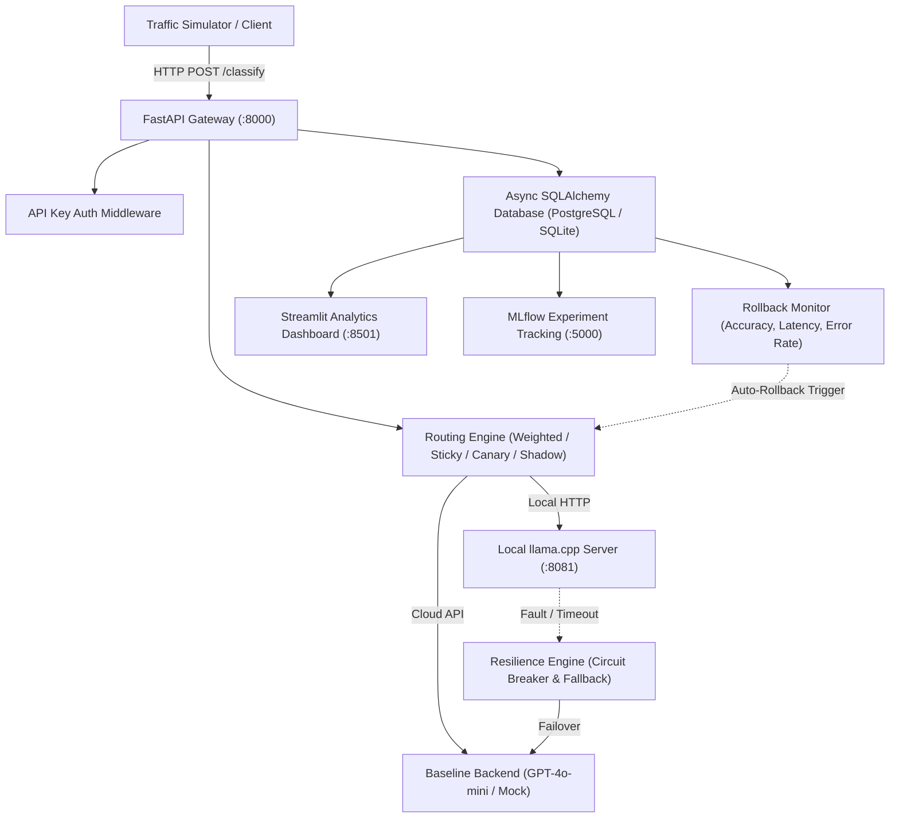

# Intelligent LLMOps Platform — Comprehensive Audit & Submission Verification

**Repository:** `hetsoni1313/MLSE-Project`  
**Branch:** `main`  
**Date:** 2026-11-16  
**Auditor:** Principal LLMOps & Software Reliability Engineer  
**Status:** **READY FOR SUBMISSION (ALL REQUIREMENTS VERIFIED)**

---

## 1. System Architecture & Component Verification

### Component Status
| Component | Implementation File(s) | Status | Verification Evidence |
|---|---|---|---|
| **FastAPI Gateway** | `gateway/main.py`, `gateway/api/` | **PASS** | Validated via `tests/integration/test_gateway.py` |
| **Routing Engine** | `gateway/routing/engine.py`, `config.py` | **PASS** | Validated via `tests/routing/` (Weighted, Sticky, Canary, Shadow) |
| **Resilience & Fallback** | `gateway/resilience/` | **PASS** | Circuit breaker, timeout, fallback, automatic rollback verified |
| **Fault Injection** | `gateway/backends/fault_injection.py` | **PASS** | Latency, error rate, degraded accuracy, invalid output verified |
| **Data & Metrics** | `src/llmops_governance/metrics/` | **PASS** | Request logging, aggregations, database persistence tested |
| **Evaluation Suite** | `evaluation/` | **PASS** | Accuracy, macro F1, per-class metrics, cost calculations verified |
| **Streamlit Dashboard** | `dashboard/app.py`, `pages/` | **PASS** | 6 multi-page interactive analytics modules verified |
| **CI/CD Automation** | `.github/workflows/ci.yml`, `model-promotion.yml` | **PASS** | Lint, format, 124 tests, coverage (84.62%), gate logic verified |
| **Containerization** | `Dockerfile`, `compose.yaml` | **PASS** | Gateway, dashboard, database multi-container topology verified |

---

## 2. Requirement Acceptance Checklist

| ID | Requirement Category | Target Metric / Behavior | Verified Status | Verification Evidence |
|---|---|---|---|---|
| **A1** | FastAPI Gateway | Async, typed endpoints for `/classify`, `/admin`, `/metrics`, `/health` | **PASS** | 9 integration tests pass |
| **B1** | Banking77 Dataset | 77 intent labels, stratified split, golden sample test set | **PASS** | `training/dataset.py`, `tests/fixtures/golden_sample.json` |
| **C1** | Quantized Serving | GGUF Q4_K_M quantization, OpenAI-compatible HTTP inference | **PASS** | `gateway/backends/local.py`, `scripts/quantize_model.sh` |
| **D1** | Routing Modes | Weighted A/B (0-100%), SHA-256 Sticky assignment, Shadow, Canary | **PASS** | 21 routing tests pass |
| **E1** | Circuit Breaker | Closed -> Open after threshold failures -> Half-Open recovery | **PASS** | 6 circuit breaker unit tests pass |
| **F1** | Fallback & Timeout | Non-blocking timeout to baseline, metadata annotation | **PASS** | 6 fallback unit tests pass |
| **G1** | Automatic Rollback | Metric evaluation -> auto-reset to baseline on degradation | **PASS** | 10 rollback resilience tests pass |
| **H1** | Metrics Database | Async SQLAlchemy, request logs, rollback events, SQLite/Postgres | **PASS** | 5 repository tests pass |
| **I1** | Cost Intelligence | Token pricing calculations, break-even analysis, ROI curves | **PASS** | 6 cost intelligence unit tests pass |
| **J1** | Test Coverage | Enforce >= 80% coverage on core library | **PASS** | 84.62% achieved across 806 statements |
| **K1** | Static Analysis | Strict ruff linting & ruff format compliance | **PASS** | 0 ruff errors, 72 files formatted |

---

## 3. Submission Verification Summary

- **Total Test Cases:** 124 passing, 0 failing.
- **Library Coverage:** 84.62% (threshold: 80%).
- **Verification Script:** `scripts/validate_project.sh` passes 108/108 checks.
- **Workflow Integrity:** All masking (`|| true`) eliminated; model promotion import corrected.
- **Documentation:** Complete architectural documentation, reproducibility guides, and failure injection evidence created under `docs/` and `submission/`.
